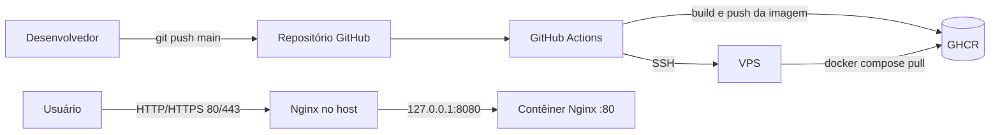

# Projeto Integrador — Cloud Computing & DevOps

Aplicação web estática, executada em contêiner Docker, com integração e entrega contínuas (CI/CD) por meio do GitHub Actions e publicação em uma VPS. Este documento descreve a aplicação, a arquitetura, as tecnologias, os processos de instalação, implantação e operação.

## Sumário

1. [Descrição da aplicação](#1-descrição-da-aplicação)
2. [Arquitetura do ambiente](#2-arquitetura-do-ambiente)
3. [Tecnologias utilizadas](#3-tecnologias-utilizadas)
4. [Estrutura do projeto](#4-estrutura-do-projeto)
5. [Processo de instalação](#5-processo-de-instalação)
6. [Processo de deploy](#6-processo-de-deploy)
7. [Configuração do Docker](#7-configuração-do-docker)
8. [Configuração do DNS](#8-configuração-do-dns)
9. [Configuração do HTTPS](#9-configuração-do-https)
10. [Processo de CI/CD](#10-processo-de-cicd)
11. [Monitoramento](#11-monitoramento)
12. [Procedimentos básicos de recuperação](#12-procedimentos-básicos-de-recuperação)
13. [Integrantes](#13-integrantes)

---

## 1. Descrição da aplicação

A aplicação é uma página web estática desenvolvida para o Projeto Integrador da disciplina de Cloud Computing e DevOps. Seu objetivo é servir como base para demonstrar, na prática, conceitos de containerização, computação em nuvem, integração e entrega contínuas, DNS, HTTPS, monitoramento e implantação em ambiente de produção.

A página apresenta o título do projeto, uma breve descrição e a lista de integrantes do grupo. Por ser estática, não possui banco de dados nem processamento no servidor.

## 2. Arquitetura do ambiente

O código-fonte é hospedado no GitHub. A cada atualização da branch `main`, o GitHub Actions valida a aplicação, constrói a imagem Docker, publica a imagem no GitHub Container Registry (GHCR) e executa o deploy em uma VPS por SSH. Na VPS, o Docker Compose baixa a nova imagem e reinicia o contêiner, que serve a página por meio do Nginx. A porta do contêiner é publicada apenas na interface local da VPS (`127.0.0.1:8080`), de modo que o acesso externo (portas 80 e 443) é recebido pelo Nginx, instalado como proxy reverso no próprio host, que encaminha as requisições ao contêiner e termina o HTTPS.



| Componente | Descrição |
|---|---|
| Repositório | GitHub (branch `main`) |
| Registro de imagens | GitHub Container Registry (`ghcr.io`) |
| Servidor | Instância EC2 na AWS (Amazon Web Services), sistema operacional Ubuntu, com Elastic IP `54.94.72.30` |
| Contêiner | `nginx:alpine` servindo o `index.html`, publicado em `127.0.0.1:8080` |
| Proxy reverso | Nginx instalado diretamente no host Ubuntu; recebe as portas 80/443 e encaminha para `127.0.0.1:8080` |
| Certificado HTTPS | Let's Encrypt, emitido e renovado pelo Certbot (plugin do Nginx) |
| Domínio | `amigosdoxisto.tuzihd.com.br` (endereço de acesso: https://amigosdoxisto.tuzihd.com.br/) |

## 3. Tecnologias utilizadas

| Tecnologia | Finalidade |
|---|---|
| HTML5 e CSS3 | Construção da página |
| Nginx (imagem `nginx:alpine`) | Servidor web dentro do contêiner |
| Docker | Empacotamento e execução da aplicação |
| Docker Compose | Orquestração do serviço na VPS |
| GitHub | Hospedagem do código e controle de versão |
| GitHub Actions | Pipelines de CI/CD |
| GitHub Container Registry (GHCR) | Armazenamento das imagens |
| SSH (`appleboy/ssh-action@v1.0.0`) | Execução remota do deploy na VPS |

## 4. Estrutura do projeto

```text
Projeto_Integrador_Cloud_DevOps/
├── .github/
│   └── workflows/
│       ├── 1-test.yml       # Pipeline de teste e validação
│       └── 2-build.yml      # Pipeline de build, publicação e deploy
├── .gitignore
├── Dockerfile               # Definição da imagem da aplicação
├── docker-compose.yml       # Definição do serviço executado na VPS
├── index.html               # Página da aplicação
└── README.md                # Documentação
```

## 5. Processo de instalação

### Pré-requisitos

- Git
- Docker e Docker Compose

### Execução local

1. Clonar o repositório:

   ```bash
   git clone https://github.com/guilhermexisto/Projeto_Integrador_Cloud_DevOps.git
   cd Projeto_Integrador_Cloud_DevOps
   ```

2. Construir a imagem:

   ```bash
   docker build -t projeto-integrador .
   ```

3. Executar o contêiner:

   ```bash
   docker run -d --name projeto-integrador -p 8080:80 projeto-integrador
   ```

4. Acessar `http://localhost:8080` no navegador.

5. Para encerrar:

   ```bash
   docker stop projeto-integrador && docker rm projeto-integrador
   ```

### Preparação da VPS (primeira vez)

1. Instalar Docker e Docker Compose no Ubuntu da VPS.
2. Clonar o repositório em `~/apps/Projeto_Integrador_Cloud_DevOps`.
3. Liberar as portas 22 (SSH) 80 (HTTP) e 443 (HTTPS) nas regras de entrada do *Security Group* da AWS associado à instância. A porta 8080 não precisa ser liberada, pois o contêiner escuta apenas em `127.0.0.1`.
4. Instalar o Nginx no host e configurá-lo como proxy reverso para encaminhar as requisições ao contêiner em `127.0.0.1:8080`, emitindo o certificado com o Certbot (ver seção 9):

   ```bash
   sudo apt update
   sudo apt install -y nginx certbot python3-certbot-nginx
   ```
5. Configurar o acesso SSH por chave para o usuário utilizado no deploy.
6. Cadastrar os *secrets* no GitHub (ver seção 10).

## 6. Processo de deploy

O deploy é automatizado e ocorre a cada `push` na branch `main`:

1. O GitHub Actions constrói a imagem e a publica no GHCR com a tag `latest`.
2. O workflow conecta-se à VPS por SSH.
3. Na VPS, são executados, em sequência:

   ```bash
   cd ~/apps/Projeto_Integrador_Cloud_DevOps
   git pull origin main
   docker compose pull
   docker compose up -d --remove-orphans
   ```

Deploy manual (em caso de necessidade), diretamente na VPS:

```bash
cd ~/apps/Projeto_Integrador_Cloud_DevOps
git pull origin main
docker compose pull
docker compose up -d --remove-orphans
```

## 7. Configuração do Docker

### Dockerfile

```dockerfile
FROM nginx:alpine
COPY index.html /usr/share/nginx/html/index.html
EXPOSE 80
CMD ["nginx", "-g", "daemon off;"]
```

- `FROM nginx:alpine`: imagem base leve do Nginx.
- `COPY`: copia a página para o diretório servido pelo Nginx.
- `EXPOSE 80`: documenta a porta utilizada pelo contêiner.
- `CMD`: mantém o Nginx em primeiro plano, requisito para o contêiner permanecer ativo.

### docker-compose.yml

```yaml
services:
  web:
    image: ghcr.io/guilhermexisto/projeto_integrador_cloud_devops:latest
    ports:
      - "127.0.0.1:8080:80"
    restart: unless-stopped
```

- `image`: imagem publicada pela pipeline no GHCR.
- `ports`: mapeia a porta 8080 da interface local (`127.0.0.1`) da VPS para a porta 80 do contêiner. Com isso, o contêiner não fica exposto diretamente à internet e só é acessível por processos do próprio host, como o proxy reverso.
- `restart: unless-stopped`: reinicia o contêiner automaticamente após falhas ou reinicialização da VPS, exceto se for parado manualmente.

Não há volumes, redes personalizadas ou variáveis de ambiente, pois a aplicação é estática.

## 8. Configuração do DNS

O domínio da aplicação é um subdomínio da zona `tuzihd.com.br`, e o apontamento para a VPS é feito por um registro do tipo A no painel de DNS.

| Item | Valor |
|---|---|
| Domínio | `amigosdoxisto.tuzihd.com.br` |
| Gerenciamento do DNS | Painel configurado pelo responsável pelo domínio |
| Registro tipo A | Nome: `amigosdoxisto` → Elastic IP da instância EC2: `54.94.72.30` |
| TTL | 14400 segundos (4 horas) |
| Prioridade | 0 |
Verificação da propagação:

```bash
nslookup amigosdoxisto.tuzihd.com.br
dig amigosdoxisto.tuzihd.com.br +short    # deve retornar 54.94.72.30
```

O registro aponta para um Elastic IP associado à instância EC2. Por ser um endereço público fixo, ele não muda quando a instância é parada e reiniciada, o que mantém o registro A válido sem necessidade de alteração no DNS.

## 9. Configuração do HTTPS

O contêiner serve apenas HTTP e escuta somente em `127.0.0.1:8080`. O HTTPS é terminado no Nginx, instalado diretamente no host Ubuntu, que recebe as conexões nas portas 80 e 443 e as encaminha ao contêiner.

O certificado é emitido pela autoridade certificadora Let's Encrypt, por meio do Certbot com o plugin do Nginx. A emissão foi concluída com sucesso e a renovação automática está habilitada pelo próprio Certbot.

Comandos utilizados e de verificação:

```bash
# Emissão do certificado (o plugin ajusta a configuração do Nginx)
sudo certbot --nginx -d amigosdoxisto.tuzihd.com.br

# Verificação da renovação automática
sudo certbot renew --dry-run
systemctl list-timers | grep certbot

# Verificação do certificado em uso
curl -vI https://amigosdoxisto.tuzihd.com.br
```

Exemplo ilustrativo da configuração do proxy reverso (o arquivo real fica em `/etc/nginx/sites-enabled/` e deve substituir este exemplo, pois o Certbot acrescenta as diretivas de certificado e o redirecionamento de HTTP para HTTPS):

```nginx
server {
    listen 80;
    server_name amigosdoxisto.tuzihd.com.br;

    location / {
        proxy_pass http://127.0.0.1:8080;
        proxy_set_header Host $host;
        proxy_set_header X-Real-IP $remote_addr;
        proxy_set_header X-Forwarded-Proto $scheme;
    }
}
```

## 10. Processo de CI/CD

O projeto possui dois workflows em `.github/workflows/`, ambos disparados por `push` na branch `main`.

### 1 - Teste e Validação CI (`1-test.yml`)

1. Baixa o código do repositório.
2. Constrói a imagem (`docker build`).
3. Executa o contêiner localmente na porta 8080.
4. Valida a configuração do Nginx (`nginx -t`).
5. Faz uma requisição HTTP com `curl -f`; se falhar, o job é reprovado.
6. Encerra o contêiner.

### 2 - Build GHCR e Deploy VPS (`2-build.yml`)

1. Baixa o código do repositório.
2. Autentica no GHCR com o `GITHUB_TOKEN`.
3. Constrói e publica a imagem `ghcr.io/<repositório>:latest`.
4. Testa a conectividade com a porta 22 da VPS (`nc -vz -w 10`, com tempo limite de 10 segundos), o que permite identificar bloqueios de rede (como o *Security Group*) antes da etapa de deploy.
5. Acessa a VPS por SSH e atualiza o serviço (seção 6).

### Secrets utilizados

Configurados em *Settings → Secrets and variables → Actions*:

| Secret | Finalidade |
|---|---|
| `SSH_HOST` | Endereço da VPS |
| `SSH_USER` | Usuário de acesso SSH |
| `SSH_KEY` | Chave privada SSH |
| `GITHUB_TOKEN` | Fornecido automaticamente pelo GitHub para autenticação no GHCR |

### Permissões

O workflow de build declara `contents: read` e `packages: write`.

## 11. Monitoramento

A disponibilidade da aplicação é monitorada externamente pelo serviço **UptimeRobot** (plano gratuito), que não exige nenhum acesso à VPS.

| Item | Configuração |
|---|---|
| Tipo de monitor | HTTP(s) |
| URL monitorada | `https://amigosdoxisto.tuzihd.com.br` |
| Intervalo de verificação | 5 minutos |
| Alertas | E-mail, enviado quando o site fica indisponível e quando volta |
| Informações exibidas no painel | Situação atual (Acima/Abaixo), tempo de resposta, histórico de incidentes e percentual de disponibilidade (últimas 24 horas, 7 e 30 dias) |

O funcionamento foi validado em 13/10/2026: o monitor apresentou situação **Acima**, disponibilidade de 100% nas últimas 24 horas, sem incidentes, e tempo médio de resposta de 565 ms. O envio de alertas foi testado com a função de notificação de teste do painel.

Verificações manuais complementares, executadas na VPS:

```bash
docker compose ps                  # estado do contêiner
docker compose logs -f web         # logs em tempo real
docker stats                       # consumo de CPU e memória
curl -I http://127.0.0.1:8080      # contêiner, executado na própria VPS
curl -I https://amigosdoxisto.tuzihd.com.br   # disponibilidade externa, via proxy reverso
```

O resultado de cada pipeline pode ser acompanhado na aba **Actions** do repositório.

Propostas de evolução: criar uma página de status pública no UptimeRobot, adicionar um monitor de expiração do certificado SSL, e instalar uma ferramenta de monitoramento interno (como Uptime Kuma ou CloudWatch) para acompanhar o consumo de recursos da instância.

## 12. Procedimentos básicos de recuperação

Como a aplicação é estática e não possui banco de dados, o código-fonte versionado no GitHub e as imagens no GHCR são os únicos ativos a recuperar, e não há backup de dados a restaurar.

**Reiniciar o serviço**

```bash
cd ~/apps/Projeto_Integrador_Cloud_DevOps
docker compose restart
```

**Recriar o contêiner**

```bash
docker compose down
docker compose pull
docker compose up -d
```

**Reverter para uma versão anterior do código**

1. Identificar o commit estável: `git log --oneline`.
2. Reverter o commit problemático no repositório (`git revert <hash>`) e enviar para `main`; a pipeline publicará e implantará a versão corrigida.

**Reconstruir a VPS do zero**

1. Criar a instância EC2 com Ubuntu e associar a ela o Elastic IP (`54.94.72.30`), o que dispensa alterar o registro DNS. Se for usado outro IP, atualizar o registro A.
2. Liberar as portas 22, 80 e 443 no *Security Group*.
3. Instalar Docker, Docker Compose, Nginx e Certbot.
4. Clonar o repositório e subir o serviço (`docker compose up -d`).
5. Recriar a configuração do Nginx (proxy para `127.0.0.1:8080`) e emitir novamente o certificado com `sudo certbot --nginx -d amigosdoxisto.tuzihd.com.br`.
6. Restabelecer o acesso SSH da pipeline e atualizar os secrets `SSH_HOST`, `SSH_USER` e `SSH_KEY`.

## 13. Integrantes

- Guilherme Henrique Xisto da Silva
- Lael Cândido Batista Veiga
- Vinicius de Oliveira Mateus
- Arthur Leite
- João Vitor Davy Campos Arruda
- João Pedro Moraes Silva