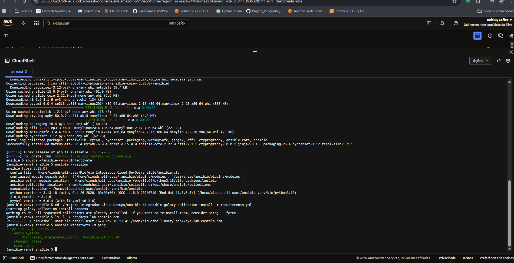

# Evidências da entrega

Prints salvos em [`docs/evidencias/`](evidencias/) e referenciados aqui. O ambiente precisa estar **funcionando**: os prints são complemento da demonstração ao vivo.

## Links

| Item | Endereço |
|---|---|
| Aplicação | https://3.142.172.36 (`http://3.142.172.36` redireciona para HTTPS) |
| Health check | https://3.142.172.36/health |
| Monitoramento (Uptime Kuma) | https://3.142.172.36:3001 |
| Repositório | https://github.com/GuilhermeXisto/Projeto_Integrador_Cloud_DevOps |
| Imagem (GHCR) | `ghcr.io/guilhermexisto/projeto_integrador_cloud_devops` |

> O HTTPS usa certificado **autoassinado** (não há domínio, então o Let's Encrypt não emite certificado). No primeiro acesso o navegador mostra "Não seguro": clique em *Avançado → Continuar*. Pelo terminal, use `curl -k`.

---

## N2 — Automação com Ansible

Comandos executados a partir do AWS CloudShell (ou WSL/Linux), dentro da pasta `ansible/`, e na VM `3.142.172.36`.

| # | Evidência | Comando | Print |
|---|---|---|---|
| 1 | Conexão do Ansible com o servidor | `ansible webservers -m ping` → `"ping": "pong"` | `evidencias/n2-01-ansible-ping.png` |
| 2 | Execução do playbook | `ansible-playbook playbook.yml` → `PLAY RECAP` com `failed=0` | `evidencias/n2-02-playbook.png` |
| 3 | Idempotência (2ª execução) | `ansible-playbook playbook.yml` de novo → `changed` baixo, `failed=0` | `evidencias/n2-03-idempotencia.png` |
| 4 | Docker instalado pelo Ansible | na VM: `docker --version && docker compose version` | `evidencias/n2-04-docker-versao.png` |
| 5 | Stacks em funcionamento | na VM: `cd /opt/projeto-cloud-devops && docker compose ps` | `evidencias/n2-05-compose-ps.png` |
| 6 | Aplicação respondendo | `curl -k https://3.142.172.36/health` | `evidencias/n2-06-health.png` |
| 7 | Acesso pelo navegador | https://3.142.172.36 (disciplina, integrantes, versão/commit no rodapé) | `evidencias/n2-07-navegador-app.png` |
| 8 | Monitoramento | https://3.142.172.36:3001 com os monitores verdes | `evidencias/n2-08-uptime-kuma.png` |

<!-- Para mostrar um print aqui, use:  -->

**Reprodução em servidor novo:** criar uma EC2 Ubuntu, liberar 22/80/443/3001 no Security Group, trocar o IP em `ansible/inventory.ini` e rodar `ansible-playbook playbook.yml`.

---

## N1 — Construção e implantação

### Cloud (AWS EC2)
- [ ] Console da AWS mostrando a instância (`i-094900e790207c84f`, IP `3.142.172.36`, estado *running*)
- [ ] Security Group `launch-wizard-1` com as portas 22, 80, 443 e 3001 liberadas
- [ ] Terminal: `ssh -i keys-lab-castelo.pem ubuntu@3.142.172.36` conectado + `lsb_release -a`, `nproc`, `free -h`, `df -h`
- [ ] `sudo ufw status verbose`

### Docker
- [ ] `docker images`
- [ ] `docker compose ps` (todos `Up`, app `healthy`)
- [ ] `docker logs --tail 20 app`

### Acesso e HTTPS
- [ ] Navegador em https://3.142.172.36 + detalhes do certificado (autoassinado, emitido pelo Traefik)
- [ ] `curl -I http://3.142.172.36` mostrando o redirecionamento (301/308) para `https://`
- [ ] `curl -k https://3.142.172.36/health` retornando `{"status":"ok", ...}`

### CI/CD
- [ ] Aba Actions com os 3 workflows verdes (Testes → Build e Push → Deploy)
- [ ] Log do job de deploy com "✅ Nova versão no ar"
- [ ] Antes/depois de uma alteração (rodapé com versão/commit diferentes)
- [ ] Página do pacote no GHCR com as tags (`latest` e o SHA do commit)

### Monitoramento
- [ ] Painel do Uptime Kuma (https://3.142.172.36:3001) com os monitores verdes
- [ ] Simulação: `docker stop app` → monitor vermelho → `docker compose up -d` → volta verde
- [ ] Saída do `bash scripts/diagnostico.sh`

### Git
- [ ] `git log --oneline --graph` mostrando o histórico
